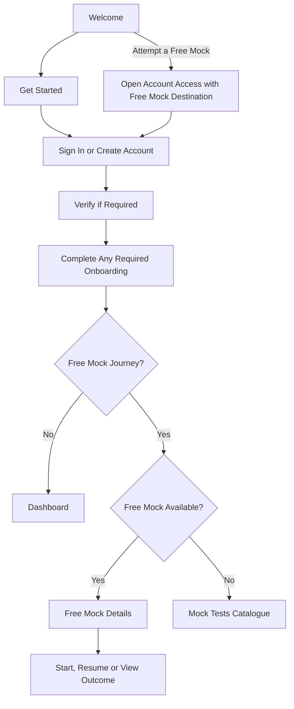
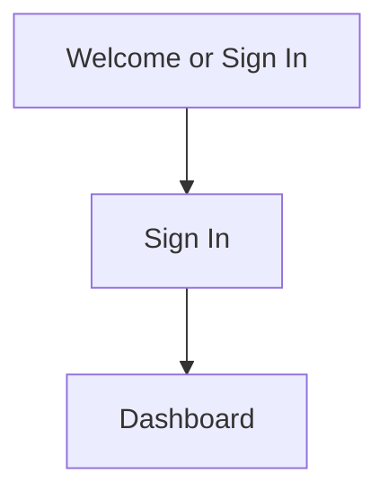
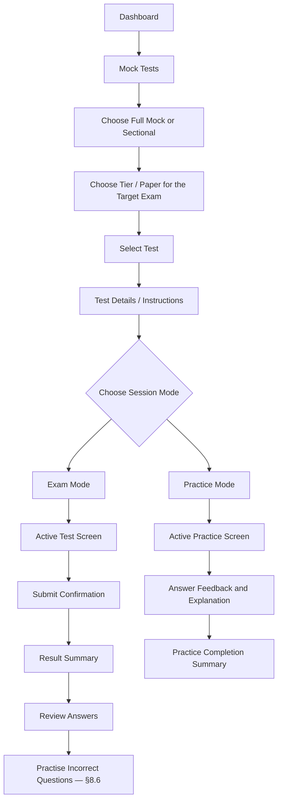
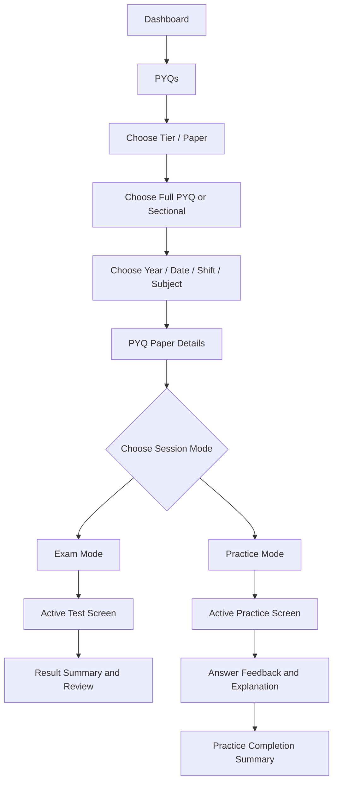
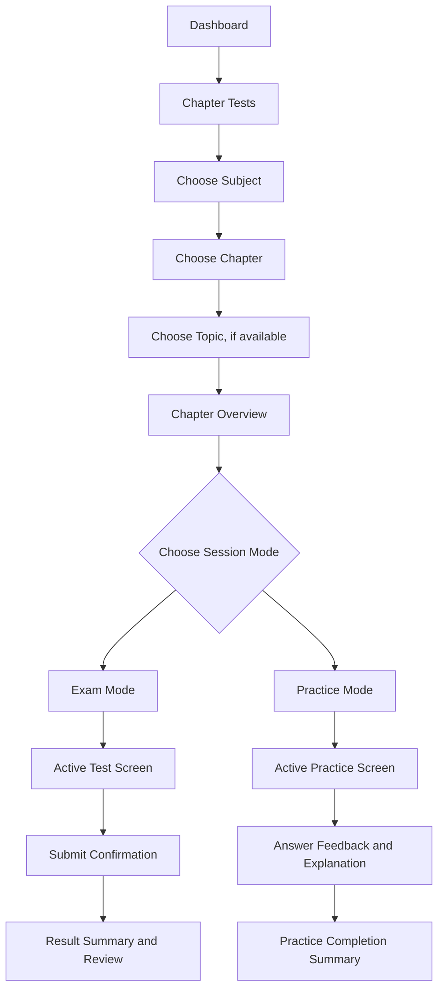
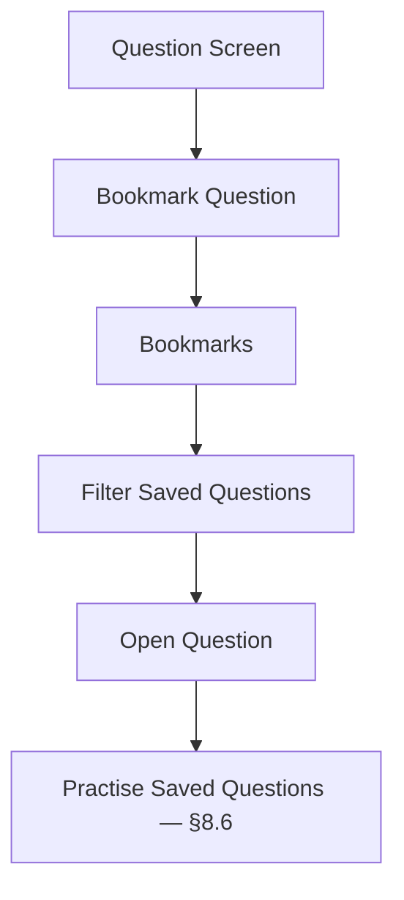
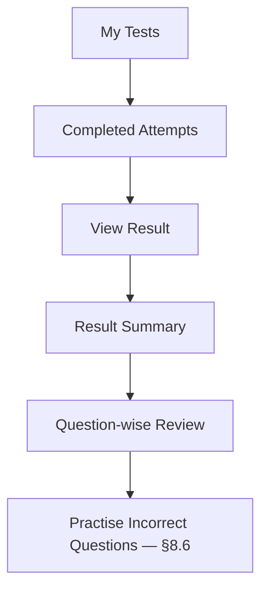
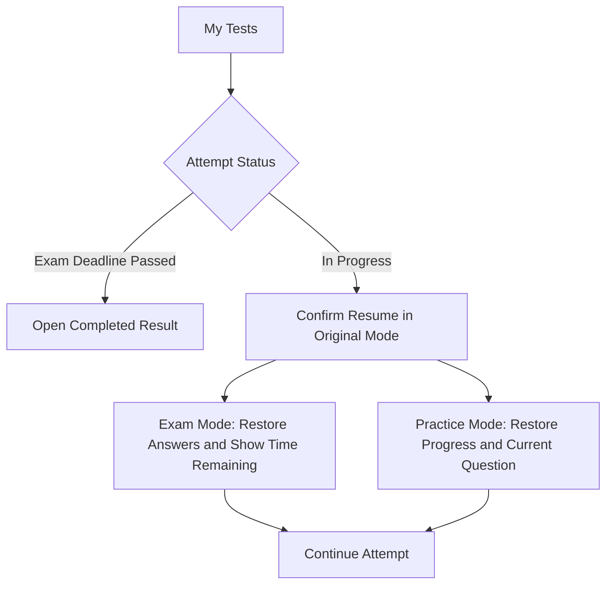

# SSC Flix — UI/UX Design Architecture

**Document type:** Product UI/UX design specification  
**Scope:** Student-facing website experience only  
**Purpose:** A practical design reference for planning, designing, prototyping and reviewing the SSC Flix interface.

> This document describes what users see and how they move through the website. It is a design specification, not a technical or backend architecture. It does not define databases, APIs, authentication implementation, question-bank structure, server logic, admin tools or deployment.

---

## 1. UI/UX design direction

### 1.1 Product experience

SSC Flix is a student-facing SSC exam preparation portal. Its interface should make it easy for students to find a test, practise questions, review performance and continue studying without unnecessary navigation or visual clutter.

The experience should revolve around four primary study activities:

1. **Dashboard** — see study progress and continue learning.
2. **Mock Tests** — find and start full-length or sectional mock tests.
3. **PYQs** — select and practise previous-year papers and questions.
4. **Chapter Tests** — practise by subject, chapter and topic.

Supporting areas such as My Tests, Bookmarks, Results, Preferences and Profile should remain accessible without competing with the four primary activities.

### 1.2 Design principles

- **Clarity first:** Every screen should make its purpose and primary action immediately understandable.
- **Study-first hierarchy:** Test discovery, question content and progress information should receive more attention than decoration.
- **Consistent patterns:** Similar controls and interactions should look and behave consistently across pages.
- **Mobile-first:** Design the phone experience first, then adapt it for tablet and desktop.
- **Low-friction navigation:** Students should be able to move between the main study areas without repeatedly returning to the dashboard.
- **Progressive disclosure:** Show essential information first. Place secondary settings, filters and details where they are needed.
- **Readable content:** Question text, answer options, labels and controls must remain comfortable to read on small screens.
- **Calm visual language:** Use a restrained colour palette, clear spacing and limited decoration.
- **Accessible interaction:** Do not rely on colour alone to communicate selection, status or correctness.

### 1.3 Overall visual direction

Use a modern, minimalist learning-platform style:

- Light appearance as the default.
- Optional dark appearance with equivalent contrast and hierarchy.
- A restrained purple/lavender accent family for primary actions and selected states.
- Neutral surfaces for cards, navigation and content areas.
- Clear typography with distinct page titles, section headings, labels and supporting text.
- Consistent icon style and stroke weight.
- Subtle borders and shadows only where they help separate content.
- Compact desktop layouts without making mobile controls or text too small.

Do not redesign the brand mark as part of routine page refinements. Treat the logo as a replaceable brand asset while preserving its allocated space and proportions.

---

## 2. Improved website tree and screen hierarchy

This tree is the **screen-level map** of the student-facing website. It separates full pages from page sections, selectable states and shared overlays. A child item does not automatically need its own URL or separate page: items such as filters, confirmation dialogs and question states are parts of their parent screen unless the user journey requires a dedicated screen.

### 2.1 Complete UI/UX website tree

```text
SSC FLIX — STUDENT-FACING WEBSITE
│
├── 00. SHARED WEBSITE EXPERIENCE
│   │
│   ├── A. Public Website Shell
│   │   ├── Public Header
│   │   │   ├── SSC Flix Logo
│   │   │   ├── Sign In
│   │   │   └── Get Started
│   │   ├── Public Page Container
│   │   └── Public Footer
│   │       ├── About SSC Flix
│   │       ├── Contact / Support
│   │       ├── FAQs
│   │       ├── Privacy Policy
│   │       ├── Terms & Conditions
│   │       └── Disclaimer
│   │
│   ├── B. Student Workspace Shell
│   │   ├── Desktop Sidebar
│   │   │   ├── Brand / Logo
│   │   │   ├── Dashboard
│   │   │   ├── Mock Tests
│   │   │   ├── PYQs
│   │   │   ├── Chapter Tests
│   │   │   ├── My Tests
│   │   │   ├── Bookmarks
│   │   │   ├── Leaderboard (Phase 4)
│   │   │   └── Preferences
│   │   ├── Shared Header
│   │   │   ├── Target Exam Switcher
│   │   │   ├── Global Search
│   │   │   ├── Theme Toggle
│   │   │   ├── Notifications
│   │   │   └── Avatar / Profile Menu
│   │   ├── Main Content Area
│   │   └── Shared Feedback / Overlay Layer
│   │
│   ├── C. Mobile Navigation Shell
│   │   ├── Compact Header
│   │   │   ├── Brand / Logo
│   │   │   ├── Target Exam Switcher
│   │   │   ├── Theme Toggle
│   │   │   └── Avatar / Quick Menu
│   │   ├── Fixed Bottom Navigation
│   │   │   ├── Dashboard
│   │   │   ├── Mock Tests
│   │   │   ├── PYQs
│   │   │   ├── Chapter Tests
│   │   │   └── More
│   │   └── More Menu / More Screen
│   │       ├── My Tests
│   │       ├── Bookmarks
│   │       ├── Leaderboard (Phase 4)
│   │       ├── Preferences
│   │       ├── Profile
│   │       └── Help / Support
│   │
│   └── D. Shared Interface Elements
│       ├── Page Title / Description
│       ├── Tabs / Segmented Controls
│       ├── Search and Filter Controls
│       ├── Cards / List Rows
│       ├── Dropdowns / Select Menus
│       ├── Drawers / Mobile Bottom Sheets
│       ├── Dialogs / Confirmation Modals
│       ├── Toasts / Inline Alerts
│       ├── Loading Skeletons
│       ├── Empty States
│       ├── Error / Retry States
│       └── Tooltips / Help Text
│
├── 01. PUBLIC WEBSITE
│   │
│   ├── A. Welcome Page
│   │   ├── Header
│   │   │   ├── Logo
│   │   │   ├── Sign In
│   │   │   └── Get Started
│   │   ├── Hero Section
│   │   │   ├── Main Value Proposition
│   │   │   ├── Supporting Text
│   │   │   ├── Attempt a Free Mock (Primary CTA)
│   │   │   └── Get Started (Secondary CTA, where appropriate)
│   │   ├── Learning Approach
│   │   │   ├── Practise
│   │   │   ├── Understand
│   │   │   └── Improve
│   │   ├── Core Study Tools
│   │   │   ├── Mock Tests
│   │   │   ├── Previous Year Questions
│   │   │   └── Chapter Tests
│   │   ├── How It Works
│   │   ├── Final Call to Action
│   │   └── Footer
│   │
│   ├── B. About SSC Flix
│   ├── C. Contact / Support
│   ├── D. FAQs
│   ├── E. Privacy Policy
│   ├── F. Terms & Conditions
│   └── G. Disclaimer
│
├── 02. ACCOUNT AND ACCESS SCREENS
│   │
│   ├── A. Sign In
│   │   ├── Email
│   │   ├── Password / Show-Hide Password
│   │   ├── Sign In Action
│   │   ├── Forgot Password Link
│   │   └── Create Account Link
│   │
│   ├── B. Create Account
│   │   ├── Full Name
│   │   ├── Email
│   │   ├── Password / Show-Hide Password
│   │   ├── Create Account Action
│   │   └── Existing Account / Sign In Link
│   │
│   ├── C. Email / OTP Verification
│   │   ├── Verification Message
│   │   ├── Masked Email Address
│   │   ├── OTP Entry
│   │   ├── Verify Action
│   │   ├── Resend Code
│   │   └── Change Email / Return Action
│   │
│   ├── D. Forgot Password
│   │   ├── Email Entry
│   │   └── Send OTP Action
│   │
│   ├── E. Password Reset
│   │   ├── OTP Verification (when required)
│   │   ├── New Password
│   │   ├── Confirm Password
│   │   └── Reset Password Action
│   │
│   └── F. Sign Out Confirmation (shared dialog)
│
├── 03. FIRST-TIME ONBOARDING
│   │
│   ├── A. Onboarding Introduction
│   ├── B. Choose Target Exam
│   │   ├── SSC CGL
│   │   ├── SSC CHSL
│   │   ├── SSC CPO
│   │   ├── SSC MTS
│   │   ├── SSC GD
│   │   └── SSC Stenographer
│   ├── C. Choose Language
│   │   ├── English
│   │   └── Hindi
│   ├── D. Review Preferences
│   │   ├── Selected Exam
│   │   ├── Selected Language
│   │   ├── Edit / Back Actions
│   │   └── Continue to Dashboard
│   └── E. Onboarding Completion State
│
└── 04. STUDENT LEARNING WORKSPACE
    │
    ├── A. DASHBOARD
    │   ├── Welcome / Greeting
    │   │   ├── Student Greeting
    │   │   └── Current Target Exam
    │   ├── Continue Learning (when available)
    │   │   ├── Resume In-progress Mock / Sectional Test (in its original mode)
    │   │   ├── Resume In-progress PYQ (in its original mode)
    │   │   └── Continue Recent Chapter Test (in its original mode)
    │   ├── Quick Actions
    │   │   ├── Start Mock Test
    │   │   ├── Practise PYQs
    │   │   └── Start Chapter Test
    │   ├── Study Overview
    │   │   ├── Tests Completed
    │   │   ├── Questions Attempted
    │   │   ├── Average Accuracy
    │   │   └── Average Score (where relevant)
    │   ├── Recent Activity
    │   │   ├── Recent Mock / Sectional Attempts
    │   │   ├── Recent PYQ Attempts
    │   │   ├── Recent Chapter Practice
    │   │   └── View All → My Tests
    │   ├── Performance Snapshot
    │   │   ├── Score Trend
    │   │   ├── Subject-wise Accuracy
    │   │   ├── Strong Areas
    │   │   └── Weak Areas
    │   └── Recommended Next Action
    │
    ├── B. MOCK TESTS
    │   ├── Mock Test Catalogue
    │   │   ├── Full Mock
    │   │   ├── Sectional
    │   │   ├── Tier / Paper Selector (target exam comes from the header)
    │   │   ├── Attempt Status Filter (where needed)
    │   │   ├── Test Cards / Test List
    │   │   └── Empty / No Matching Tests State
    │   ├── Test Card Details
    │   │   ├── Test Name
    │   │   ├── Tier / Paper Context
    │   │   ├── Questions / Marks / Duration
    │   │   ├── Attempt Status
    │   │   └── View Details / Resume / View Result Action
    │   ├── Test Details / Instructions
    │   │   ├── Test Overview
    │   │   ├── Sections (when applicable)
    │   │   ├── Marking Scheme
    │   │   ├── Instructions
    │   │   ├── Choose Session Mode
    │   │   │   ├── Exam Mode
    │   │   │   └── Practice Mode
    │   │   ├── Selected Mode Explanation
    │   │   └── Start in Selected Mode
    │   └── Test Entry / Resume Confirmation (when needed)
    │
    ├── C. PREVIOUS YEAR QUESTIONS (PYQs)
    │   ├── PYQ Catalogue
    │   │   ├── Tier / Paper Selection
    │   │   ├── Full PYQ / Sectional Selection
    │   │   ├── Year Selection
    │   │   ├── Date / Shift Selection (where available)
    │   │   ├── Subject Filter (Sectional only)
    │   │   ├── Available Paper List / Cards
    │   │   └── Empty / No Matching Papers State
    │   ├── PYQ Paper Details
    │   │   ├── Exam / Tier / Paper
    │   │   ├── Year / Date / Shift
    │   │   ├── Question Count
    │   │   ├── Duration / Pattern (where relevant)
    │   │   ├── Choose Session Mode
    │   │   │   ├── Exam Mode
    │   │   │   └── Practice Mode
    │   │   ├── Selected Mode Explanation
    │   │   └── Start / Continue in Selected Mode
    │   └── Mode Selection State (Exam Mode / Practice Mode)
    │
    ├── D. CHAPTER TESTS
    │   ├── Subject Selection
    │   │   ├── Quantitative Aptitude
    │   │   ├── General Intelligence & Reasoning
    │   │   ├── English Comprehension
    │   │   ├── General Awareness
    │   │   └── Computer Knowledge (where applicable)
    │   ├── Chapter List
    │   │   ├── Chapter Search / Filter (when useful)
    │   │   ├── Chapter Cards / Rows
    │   │   └── Chapter Progress State (where available)
    │   ├── Topic Selection (only when topics are available)
    │   ├── Chapter Overview
    │   │   ├── Subject / Chapter Context
    │   │   ├── Available Questions
    │   │   ├── Attempted / Progress Summary
    │   │   ├── Choose Session Mode
    │   │   │   ├── Exam Mode
    │   │   │   └── Practice Mode
    │   │   ├── Selected Mode Explanation
    │   │   └── Start in Selected Mode
    │   └── Selected Mode Entry
    │
    ├── E. SHARED ASSESSMENT EXPERIENCE
    │   │
    │   ├── Shared Mode Selection Component (reused on the three detail / overview screens)
    │   │   ├── Used by Mock Tests, PYQs and Chapter Tests
    │   │   ├── Exam Mode Option
    │   │   ├── Practice Mode Option
    │   │   ├── Short Mode Description / Comparison
    │   │   ├── Selected Mode State
    │   │   └── Continue / Start in Selected Mode
    │   │
    │   ├── Assessment Entry
    │   │   ├── Activity / Test / Paper / Chapter Context
    │   │   ├── Selected Session Mode
    │   │   └── Loading / Ready State
    │   │
    │   ├── Exam Mode
    │   │   ├── Test Instructions
    │   │   ├── Start Test Confirmation (if required)
    │   │   ├── Active Test Screen
    │   │   │   ├── Test Header / Timer
    │   │   │   ├── Section Selector (where applicable)
    │   │   │   ├── Language Selector (where applicable)
    │   │   │   ├── Question Display
    │   │   │   ├── Answer Options
    │   │   │   ├── Question Utilities
    │   │   │   │   ├── Bookmark
    │   │   │   │   └── Report Question
    │   │   │   ├── Question Palette
    │   │   │   ├── Palette Status Legend
    │   │   │   └── Question Navigation
    │   │   ├── Palette Drawer / Sheet (mobile)
    │   │   ├── Submit Test Confirmation
    │   │   ├── Time Warning State
    │   │   ├── Time Expired / Auto-submit State
    │   │   └── Submission Complete State
    │   │
    │   ├── Practice Mode
    │   │   ├── Practice Setup / Entry
    │   │   ├── Active Practice Screen
    │   │   │   ├── Question Progress
    │   │   │   ├── Question Display
    │   │   │   ├── Answer Options
    │   │   │   ├── Check / Submit Answer
    │   │   │   ├── Correct / Incorrect Feedback
    │   │   │   ├── Hint (when available)
    │   │   │   ├── Explanation
    │   │   │   ├── Bookmark / Report Question
    │   │   │   └── Previous / Next / Skip (where supported)
    │   │   ├── Finish Practice Confirmation
    │   │   └── Practice Completion Summary
    │   │
    │   ├── Remediation Practice Sessions (Practice Mode only, §8.6)
    │   │   ├── Practise Incorrect Questions (from Result Review)
    │   │   └── Practise Saved Questions (from Bookmarks)
    │   │
    │   └── Shared Question Presentation
    │       ├── Question Number / Status
    │       ├── Question Text / Media
    │       ├── Answer Options
    │       ├── Selected Answer State
    │       ├── Correct / Incorrect State (Practice / Review)
    │       ├── Explanation / Hint Area
    │       ├── Bookmark Action
    │       └── Report Question Action
    │
    ├── F. RESULTS & PERFORMANCE
    │   ├── Result Summary
    │   │   ├── Score / Maximum Marks
    │   │   ├── Correct / Incorrect / Unattempted
    │   │   ├── Accuracy
    │   │   ├── Time Taken
    │   │   ├── Section Summary (where relevant)
    │   │   └── Result Actions
    │   ├── Section-wise Analysis (where relevant)
    │   ├── Question-wise Review
    │   │   ├── All Questions
    │   │   ├── Correct
    │   │   ├── Incorrect
    │   │   ├── Unattempted
    │   │   ├── Bookmarked
    │   │   ├── Student's Answer
    │   │   ├── Correct Answer
    │   │   └── Explanation / Hint
    │   ├── Performance Insights
    │   │   ├── Score Progress
    │   │   ├── Accuracy Progress
    │   │   ├── Subject-wise Performance
    │   │   ├── Chapter / Topic Performance (when sufficient data exists)
    │   │   ├── Strong Areas
    │   │   ├── Weak Areas
    │   │   └── Time Management
    │   └── Practise Incorrect Questions
    │
    ├── G. MY TESTS
    │   ├── All Attempts
    │   ├── In Progress
    │   ├── Completed
    │   ├── Time Expired Label (on auto-submitted attempts)
    │   ├── Source / Activity Filter
    │   │   ├── Mock Test
    │   │   ├── Sectional Test
    │   │   ├── PYQ Paper
    │   │   ├── Chapter Test
    │   │   └── Practice Session (§8.6)
    │   ├── Attempt Details
    │   └── Attempt Actions
    │       ├── Resume (when available)
    │       ├── View Result
    │       ├── Review Answers
    │       └── Reattempt
    │
    ├── H. BOOKMARKS
    │   ├── Saved Questions List
    │   ├── Filter by Exam
    │   ├── Filter by Subject / Chapter
    │   ├── Filter by Source
    │   ├── Question Preview / Open Question
    │   ├── Explanation View
    │   ├── Remove Bookmark
    │   └── Practise Saved Questions
    │
    ├── I. LEADERBOARD
    │   ├── Featured Mock for the Selected Exam
    │   ├── Weekly Ranking
    │   ├── Current User Position / Eligibility
    │   └── Empty / No Featured Mock State
    │
    ├── J. PREFERENCES
    │   ├── Target Exam
    │   ├── Language Preferences
    │   ├── Appearance
    │   │   ├── Light Mode
    │   │   └── Dark Mode
    │   ├── Test Preferences
    │   ├── Notifications Preferences
    │   └── Save / Updated State
    │
    └── K. PROFILE AND ACCOUNT
        ├── Profile Overview
        ├── Edit Profile
        │   ├── Full Name
        │   ├── Email (display / change where supported)
        │   └── Profile Photo (optional)
        ├── Account / Security
        │   ├── Password Change / Reset Shortcut
        │   └── Sign-in / Account Information
        ├── Help / Support Shortcut
        └── Sign Out
```

### 2.2 Main navigation structure

Keep the four core learning destinations visually dominant. Secondary pages should remain easy to reach without making the main navigation crowded.

**Desktop sidebar order**

1. Dashboard
2. Mock Tests
3. PYQs
4. Chapter Tests
5. My Tests
6. Bookmarks
7. Leaderboard (when the Leaderboard phase ships, §7.10)
8. Preferences

Profile and account actions belong in the avatar menu rather than taking another permanent sidebar position.

**Mobile bottom navigation**

`Dashboard · Mock Tests · PYQs · Chapter Tests · More`

The **More** area contains My Tests, Bookmarks, Preferences, Profile and Help / Support. Add Leaderboard when its phase ships (§7.10). Put Search and Notifications in the header’s avatar quick menu. Do not squeeze every desktop header control into the phone header.

### 2.3 Shared header and menu contents

**Desktop header**

- Target Exam switcher
- Global Search
- Theme Toggle
- Notifications
- Avatar / Profile Menu

**Mobile header**

- Brand and Target Exam switcher in the leading area
- Theme Toggle and Avatar in the trailing area
- Search, Notifications and other secondary controls inside the quick menu when space is limited

**Avatar / Profile Menu**

- Profile
- Preferences / Account Settings
- Search shortcut (mobile, when needed)
- Notifications shortcut (mobile, when needed)
- Help / Support
- Sign Out

### 2.4 Global overlays and interaction states

These are shared interface layers, not separate primary navigation destinations.

- Global Search: closed, open, typing, results, no results.
- Notifications: closed, unread indicator, open panel, empty state.
- Target Exam Switcher: closed, open, selected exam, selection confirmation if needed.
- Profile Menu: closed, open, selected destination.
- Theme Toggle: light, dark, current selection.
- Filters: default, expanded, selected, applied, cleared.
- Dialogs: submit confirmation, finish practice, sign out and other important confirmations.
- Feedback: loading, success, warning, error, empty, unavailable and retry.

### 2.5 Page relationship rules

- Welcome Page leads to Sign In or Create Account. The **Attempt a Free Mock** CTA starts the free-mock journey (§6.6): account access → any required onboarding → free mock for the selected exam, with exit and return paths defined in §6.6. Exam selection is never shown on the public page.
- First-time users complete onboarding before entering the Dashboard; returning users go directly to the Dashboard.
- Dashboard quick actions link directly to Mock Tests, PYQs and Chapter Tests.
- Every new attempt in Mock Tests, PYQs and Chapter Tests opens through the shared Activity Details screen (§7.0) and follows the shared mode rules (§8.1): the student always chooses Exam Mode or Practice Mode, and the selected content never decides the mode.
- Completed Exam Mode attempts lead to Result Summary and Question-wise Review.
- Practice Mode shows feedback and explanations during the session, then a Practice Completion Summary (§8.3.1) when finished.
- My Tests provides return access to in-progress attempts, results and reviews.
- Bookmarks can open a saved question or launch a saved-question practice session.
- Result Review and Bookmarks should provide a route into incorrect-question or saved-question practice where relevant.
- Target Exam changes and appearance/language preferences are reachable without forcing the student to return to the Dashboard.

### 2.5.1 Target exam and filter scope

- The header switcher and Preferences edit the same saved **Target Exam**. Offer a clear empty state when the selected exam has no content in a catalogue.
- Dashboard progress, recommendations and Continue Learning use the target exam. My Tests opens on that exam and offers **All Exams**. Bookmarks opens on **All Exams**, with a local exam filter.
- Mock Tests, PYQs and Chapter Tests use the workspace target exam. Use the shared header switcher to change exams. Catalogue controls refine tier, paper, year, shift, subject or chapter within the selected exam.
- On an exam change, reset dependent tier, paper, year, shift, subject and chapter filters. Keep an activity-type tab only if the new exam supports it. If the student switches from an inactive detail page, return to the corresponding catalogue for the new exam.
- An attempt, its result and its review retain the exam and activity they started with. The shared switcher is absent during an active assessment. Changing the target elsewhere never changes or hides the original exam on an attempt's detail or history row.

### 2.6 What is a page versus a state?

| Design item | Treat it as | Example |
|---|---|---|
| Main student destination | Page | Dashboard, Mock Tests, PYQs |
| Nested content destination | Page or detail view | Test Details, Chapter Overview, Result Summary |
| Content category selection | Page state / tab | Full Mock, Sectional, Full PYQ |
| Filter selection | Page state | Tier, year, subject, attempt status |
| Temporary action layer | Overlay | Search panel, filter sheet, submit dialog |
| Question interaction | Component state | Selected option, marked for review |
| System feedback | UI state | Loading, empty, error, success |

Use a separate screen only when it provides a meaningful change in task, content hierarchy or navigation context. Keep simple selections and confirmations within the current page when that is clearer.

## 3. Global application layout

### 3.1 Desktop application shell

The desktop workspace uses a persistent sidebar, a shared top header and a scrollable main content area.

```text
┌──────────────────┬───────────────────────────────────────────────┐
│                  │ Header                                        │
│  Brand           │ Target Exam   Search   Theme   Notifications   │
│                  │                                      Avatar    │
│  Dashboard       ├───────────────────────────────────────────────┤
│  Mock Tests      │                                               │
│  PYQs            │ Main page content                             │
│  Chapter Tests   │                                               │
│  My Tests        │                                               │
│  Bookmarks       │                                               │
│  Leaderboard     │                                               │
│  Preferences     │                                               │
│                  │                                               │
│  Supporting area │                                               │
└──────────────────┴───────────────────────────────────────────────┘
```

**Sidebar design**

- Keep its width consistent across student pages.
- Use a clear brand area at the top.
- Group primary destinations together.
- Separate secondary/supporting items through spacing rather than excessive divider lines.
- Use a clear active state with both colour and shape/background treatment.
- Avoid unnecessary nested navigation.
- Keep promotional or supporting content visually separate from the main navigation.

**Header design**

- Show the current target exam in a compact switcher.
- Include global search where it is useful and supported by the design.
- Keep theme switching easy to find.
- Provide notification access where notifications are part of the experience.
- Place account options inside the avatar/profile menu.
- Do not place a redundant “Dashboard” label in the header when the page title already communicates the location.
- Keep the header height and control alignment consistent across workspace pages.

### 3.2 Mobile application shell

- Replace the persistent desktop sidebar with a fixed bottom navigation bar.
- Keep the top header compact and avoid overcrowding it with desktop controls.
- Move less frequently used controls, such as global search and account actions, into an appropriate header or profile-menu location.
- Keep the target-exam control reachable without allowing it to dominate the header.
- Ensure page content has enough bottom padding to remain visible above the bottom navigation.
- Use full-width or near-full-width content on narrow screens; avoid tiny multi-column cards.

### 3.3 Tablet layout

- Use the width thresholds and the compact tablet sidebar in §4.7.
- Allow card grids to reduce columns smoothly.
- Keep question content and question navigation usable without requiring desktop-sized space.
- Avoid desktop layouts that simply shrink every component.

### 3.4 Shared overlays and feedback

Design consistent patterns for:

- Dropdown menus
- Select menus
- Search panels
- Profile menu
- Confirmation dialogs
- Filter panels / mobile filter sheets
- Toast messages
- Tooltips
- Loading indicators
- Empty states
- Error and retry states

Overlays should have clear close behaviour, readable text and sensible placement. On mobile, use bottom sheets or full-screen panels when a small desktop-style popover would be difficult to operate.

---

## 4. Design system

The design system should be established before detailed page styling so that pages feel like parts of one product.

### 4.1 Colour roles

Define semantic colour tokens rather than assigning colours independently on every page.

| Colour role | Design use |
|---|---|
| Primary | Main CTA, active navigation and selected controls |
| Primary hover / pressed | Hover and pressed states for primary controls |
| Page background | Main application canvas |
| Surface | Cards, panels, menus and elevated content areas |
| Surface subtle | Secondary panels and grouped content |
| Border | Input outlines, card boundaries and separators |
| Text primary | Main headings and important content |
| Text secondary | Supporting labels and descriptions |
| Success | Correct answers and completed states |
| Warning | Caution, pending states and attention-needed messages |
| Danger | Incorrect answers, destructive actions and errors |
| Information | Neutral guidance and informational messages |

Use the same semantic roles in light and dark themes. Check text and control contrast in both modes.

### 4.2 Typography hierarchy

Define a consistent type scale for:

- Display / welcome hero heading
- Page title
- Section heading
- Card title
- Body text
- Supporting text
- Form label
- Input text
- Caption / metadata
- Question text
- Answer option text

Question content and mobile form labels should never be reduced merely to fit more content on screen. Use line height and spacing to improve readability.

### 4.3 Spacing and layout

- Use a consistent spacing scale.
- Align page titles, filters and content sections to a shared content grid.
- Keep card padding consistent for similar card types.
- Use enough separation between a page's exam/category selector and its filter controls.
- Avoid large empty gaps that push the main study content below the first screen.
- Avoid compressing unrelated controls into one crowded row on mobile.

### 4.4 Shape, elevation and borders

- Use a small, consistent set of corner-radius values.
- Prefer subtle borders or background contrast over heavy shadows.
- Use elevation to communicate layering, not decoration.
- Keep buttons, inputs, cards and menus visually consistent.

### 4.5 Icons

- Use one consistent icon family and stroke weight.
- Icons that are not universally recognisable should include labels or accessible names.
- Avoid mixing filled and outlined icons without a clear state-based reason.
- Use the same icon for the same action throughout the website.

### 4.6 Component states

Every interactive component should have its required visible states designed.

| Component | Required visual states |
|---|---|
| Button | Default, hover, pressed, focus, disabled, loading |
| Input | Default, focus, filled, error, disabled |
| Select / dropdown | Closed, open, selected, disabled, focus |
| Navigation item | Default, hover, active, focus |
| Tab | Default, active, focus, disabled where relevant |
| Filter chip | Unselected, selected, removable where relevant |
| Test card | Default, hover/focus, attempted or unavailable where relevant |
| Question option | Default, selected, correct, incorrect, disabled/review |
| Question palette item | Not visited, not answered, answered, marked for review, answered and marked |
| Toast | Success, information, warning, error |
| Timer display | Normal, warning (e.g. last 5 minutes), final minute, expired |
| Bookmark toggle | Unsaved, saved, transition/feedback |
| OTP input | Empty, focus, filled, error/invalid, expired, resent |
| Bottom navigation item | Default, active, focus, badge (unread) where relevant |
| Drawer / bottom sheet | Closed, opening, open, dismissed |

---

### 4.7 Phase 1 design tokens and layout defaults

Use these values across the prototype. Test all interactive states in both themes.

| Role | Light | Dark |
|---|---|---|
| Canvas | `#F8F9FC` | `#11121A` |
| Surface | `#FFFFFF` | `#191B26` |
| Muted surface | `#F1F2F7` | `#222535` |
| Text | `#1B1E2B` | `#F2F3FA` |
| Secondary text | `#51566B` | `#B8BED2` |
| Divider | `#E2E4ED` | `#373B4F` |
| Control border | `#727891` | `#838AA4` |
| Primary / hover / pressed | `#5B3CC4` / `#4D31AA` / `#412A91` | `#BAA8FF` / `#C9BBFF` / `#A895F5` |
| Text on primary | `#FFFFFF` | `#211345` |
| Selected surface / text | `#EEE9FF` / `#482A9F` | `#30254D` / `#D9CEFF` |
| Focus outline | `#6945D6` | `#CFBFFF` |
| Success / warning / danger / information text | `#17633C` / `#7A4700` / `#A32537` / `#245499` | `#83D8A7` / `#FFD17D` / `#FF9CA8` / `#A9CAFF` |

- **Typography.** Use Inter, with a Devanagari-capable fallback such as Noto Sans Devanagari for Hindi content. Use font size / line height of 32/40 px for the phone hero, 44/52 px for the desktop hero, 24/32 px for page titles, 20/28 px for section titles, 16/24 px for cards, body and options, 18/28 px for question text, and 14/20 px for labels and metadata.
- **Spacing and controls.** Use a 4, 8, 12, 16, 24, 32, 48 px spacing scale. Use 8 px radius on controls, 12 px on cards and 16 px on dialogs and sheets. Keep interactive targets at least 44 × 44 px. Use a 2 px visible focus outline with a 2 px offset. Use one outlined icon family at 20 or 24 px.
- **Shell widths.** Below 768 px, use a compact 56 px header, five bottom tabs with a minimum 64 px bar plus the device safe area, and 16 px content gutters. Allow the bar to grow for labels and preserve 44 px touch areas. From 768 to 1023 px, use a 72 px sidebar with accessible labels and a collapse/expand control, a 64 px header, and 24 px gutters. At 1024 px and above, use a 224 px sidebar, a 64 px header, and 32 px gutters. Limit the workspace content container to 1280 px and keep assessment reading text around 72 characters per line where practical.
- **Verification widths.** Review 320, 390, 768, 1024 and 1440 px. Test focus visibility, long labels, 200% zoom, both themes, and fixed controls with device safe areas. Use borders for structure and restrained elevation for overlays.

---

## 5. Public website screens

## 5.1 Welcome page

**Purpose:** Explain what SSC Flix offers and guide visitors to sign in or create an account.

**Recommended page structure**

1. Header with logo, Sign In and Get Started.
2. Hero section with a clear value proposition and primary CTA: **Attempt a Free Mock**.
3. Short supporting copy explaining the exam-preparation experience.
4. Learning approach section: Practise, Understand and Improve.
5. Core study tools: Mock Tests, Previous Year Questions and Chapter Tests.
6. How It Works section.
7. Final Get Started CTA.
8. Footer with About, Contact / Support, FAQs, Privacy Policy, Terms & Conditions and Disclaimer.

**UX requirements**

- Do not add target-exam selection to the welcome page; that belongs in the onboarding flow (see the free-mock journey, §6.6).
- Make the main CTA visually dominant.
- Keep hero copy concise and readable on a phone.
- Use a clear visual hierarchy rather than filling the page with decorative cards.
- Ensure the page transitions naturally into the account/onboarding flow.
- The footer should be complete but visually secondary.

## 5.2 Informational pages

Design About, Contact / Support and FAQs using the same public header and footer.

- Use a readable single-column content layout for long text.
- Use clear headings and spacing to support scanning.
- Use accordions for FAQ questions when that improves navigation.
- Keep contact methods and support actions easy to identify.
- Provide a visible route back to the main website.

Privacy Policy, Terms & Conditions and Disclaimer should use a plain, readable legal-content layout rather than promotional page styling.

---

## 6. Account and onboarding screens

## 6.1 Sign In

**Visible elements**

- SSC Flix logo / brand area
- Email field
- Password field with show/hide control
- Sign In button
- Forgot Password link
- Create Account link
- Inline validation and error feedback

**UX requirements**

- Keep the form focused and visually simple.
- Use clear field labels; do not rely on placeholder text as the only label.
- Show validation close to the relevant field.
- Make loading, invalid-credential and success feedback visually clear.
- On mobile, use a comfortable form width and touch-friendly controls.

## 6.2 Create Account

**Visible elements**

- Full Name
- Email
- Password
- Password visibility control
- Create Account action
- Existing-account Sign In link
- Verification step when included in the user journey

State-related or optional fields should only appear when they are genuinely part of the intended user experience. Avoid adding extra fields without a clear product need.

## 6.3 OTP / email verification

**Visible elements**

- Short explanation of the verification step
- Email destination shown in a privacy-conscious way
- OTP input boxes or a single accessible OTP field
- Verify action
- Resend option and resend feedback
- Change email / return action where appropriate

**UX requirements**

- Support pasting a complete OTP.
- Make focus movement predictable if separate OTP boxes are used.
- Show invalid, expired and resent states clearly.
- Do not make the user re-enter unrelated account information.

## 6.4 Forgot Password and reset

**Forgot Password screen**

- Email field
- Send verification / OTP action
- Return to Sign In link

**OTP verification screen**

- OTP input
- Verify action
- Resend option

**New Password screen**

- New Password
- Confirm Password
- Password visibility controls
- Reset Password action

Keep the flow linear and avoid adding unrelated information or extra panels.

## 6.5 Onboarding

**Step 1 — Introduction**

Briefly explain that the user will set up a study preference before entering the workspace.

**Step 2 — Choose Target Exam**

Show selectable exam cards or a clean selection list for:

- SSC CGL
- SSC CHSL
- SSC CPO
- SSC MTS
- SSC GD
- SSC Stenographer

The selected exam must have a clear visual state. Keep the primary Continue action obvious.

**Step 3 — Choose Language**

Show the available interface/question-language choices, such as English and Hindi, with a clear selected state.

**Step 4 — Review Preferences**

Summarise the selections and provide Back, Edit and Continue actions.

**UX requirements**

- Show progress through the onboarding steps.
- Keep one primary decision per step.
- Avoid asking for information that is not needed to complete the initial experience.
- Make preferences discoverable and editable later.
- Returning users should not be shown the first-time setup unnecessarily.

## 6.6 Free Mock entry journey (Attempt a Free Mock CTA)

The **Attempt a Free Mock** CTA takes students to the flagship free mock for their target exam. It keeps that destination through sign-in, account creation, verification and onboarding.

| Student state | Destination after selecting the CTA | Exit action |
|---|---|---|
| Signed out | Create Account with the context “Create your free account to start the mock.” Offer Sign In for existing students and preserve the destination through verification or password reset. | Back to Welcome. End the current free-mock journey. |
| Signed in, onboarding incomplete | Continue at the first unfinished onboarding step. Choose Target Exam and Language before opening the mock. The free-mock path can combine preference review with the last step. | Leave free-mock setup and go to Welcome. Retain saved selections and clear the free-mock destination. Regular access resumes any required onboarding. |
| Signed in, onboarding complete | Open the free mock's Activity Details for the current target exam. Returning students use the same destination, including after a previous attempt. | Return to Dashboard. |
| No free mock for the selected exam | Show “No free mock is available for this exam yet” and offer **Browse Mock Tests** for that exam. | Return to Dashboard. |

On Activity Details, a new student chooses a mode and starts. If an attempt is in progress, offer **Resume** with its original mode. For a completed attempt, offer **View Result** in Exam Mode or **View Practice Summary** in Practice Mode. When reattempting is allowed, offer it as a separate action that reopens the mode choice. Free-mock rotation remains a product decision in §18.

---

## 7. Student workspace screens

## 7.0 Shared "Activity Details" screen template

Mock Test Details (§7.3), PYQ Paper Details (§7.4) and Chapter Overview (§7.5) are the same screen archetype: **Activity Details**. Design them once as a shared template with a fixed content order, then apply only the per-activity deltas below. The shared mode selector (§8.1) sits in the same relative position on all three.

**Fixed template structure**

1. Activity title and context line (exam / tier / paper / year / subject / chapter as applicable)
2. Key facts row: question count, duration, maximum marks (where relevant)
3. Content composition summary (sections, marking scheme, key instructions)
4. Shared mode selector: Exam Mode / Practice Mode, with the selected-mode explanation (§8.1). Show the duration and marking scheme before starting a timed session, including Chapter Tests.
5. Primary action: **Start in Exam Mode** / **Start in Practice Mode** — the label updates with the selection
6. Back action

**Per-activity deltas**

| Delta | Mock Test | PYQ Paper | Chapter Test |
|---|---|---|---|
| Context line | Exam / tier / paper | Exam / tier / year / date / shift / subject (sectional) | Subject / chapter / topic |
| Key facts | Questions, duration, marks | Questions, duration / pattern where relevant | Available questions, attempted / progress, and Exam Mode duration and marks |
| Composition summary | Sections and marking scheme | Paper pattern where relevant | Chapter scope note |
| Resume state | Resume in-progress attempt in its original mode | Resume in-progress attempt in its original mode | Resume in-progress session in its original mode |

Exam Mode in Chapter Tests behaves exactly as Exam Mode in Mock Tests: timer, question palette, navigation and submission flow (§8.2). Chapter Tests are not configured differently from Mock Tests in this regard.

## 7.1 Dashboard

**Purpose:** Give students a quick overview and a clear next study action.

**Recommended content order**

1. Greeting and current target exam.
2. Continue Learning panel, when an in-progress activity exists.
3. Quick Actions: Start Mock Test, Practise PYQs and Start Chapter Test.
4. Study Overview: Tests Completed, Questions Attempted, Average Accuracy and Average Score where relevant.
5. Recent Activity: recent attempts, results and practice sessions.
6. Performance Snapshot: score trend, subject-wise accuracy and weak areas.
7. Recommended Next Action.

**Layout guidance**

- Put the most useful next action near the top.
- Use a clear primary action rather than giving every card equal visual weight.
- Keep study metrics compact and easy to scan.
- Use charts only where they communicate a meaningful trend.
- Avoid decorative dashboard widgets that do not help the student decide what to do next.
- On mobile, stack sections in priority order and avoid dense multi-column metric cards.

**Important visible states**

- New user with no activity.
- Returning user with recent activity.
- User with an in-progress test or practice session.
- User with insufficient data for performance trends.

## 7.2 Mock Tests catalogue

**Purpose:** Help students find a suitable full mock or sectional test.

**Recommended structure**

1. Page title and short description.
2. Test-type selection: Full Mock and Sectional.
3. Tier / Paper selection where relevant. Show the active target exam as context and change it through the shared header switcher (§2.5.1).
4. Supporting filters, such as attempted status or availability.
5. Test cards or a compact test list.

**Test card content**

- Test name
- Exam / tier context
- Question count
- Duration
- Maximum marks where relevant
- Attempt status where relevant
- Primary action: View Details, Resume or View Result

**Mode selection on Test Details**

The Test Details screen uses the shared Activity Details template (§7.0): both modes are offered under the shared mode rules (§8.1), and the primary action label reflects the selected mode.

**UX requirements**

- Keep the gap between the exam context and filter controls consistent.
- Do not overload each card with every possible metadata field.
- Keep the primary action easy to identify.
- Clearly distinguish a new test from an attempted or in-progress test.
- On mobile, use readable stacked cards and full-width controls where appropriate.

## 7.3 Test details / instructions

Before starting a new Mock Test attempt, show the Activity Details screen (§7.0) for the selected test.

**Mock-specific content**

- Test name and exam/tier
- Total questions
- Duration
- Maximum marks
- Section information where applicable
- Marking scheme summary
- Key instructions

**UX requirements**

- Highlight only the instructions that affect the student's attempt.
- The mode selector, selected-mode explanation and Start in Selected Mode action follow the shared template and shared mode rules (§7.0, §8.1).
- Use a confirmation step only when it prevents a meaningful accidental action.
- Provide a compact mobile layout without hiding important test information.

## 7.4 PYQ catalogue

**Purpose:** Let students find previous-year papers and practise questions from them.

**Recommended controls**

- Tier / Paper selection
- Full PYQ and Sectional selection
- Year selection
- Date / Shift selection where applicable
- Subject filter for sectional practice

**PYQ list/card content**

- Exam and tier/paper
- Year
- Date and shift where relevant
- Paper/question count where available
- Attempt status where relevant
- Primary action to start or continue

**Mode selection on PYQ Paper Details**

After the student selects the PYQ content (Full PYQ or Sectional, year and any relevant date, shift or subject), the Activity Details screen (§7.0) offers both modes under the shared mode rules (§8.1).

**UX requirements**

- Keep PYQ selection visually consistent with Mock Tests.
- Use Full PYQ for a full-paper content selection, not as a mode selection.
- Show the year near the Full PYQ / Sectional choice where it helps explain the selected content.
- Show subject selection when Sectional is active; do not show an irrelevant subject filter for Full PYQ.
- Keep Tier / Paper selection accessible without letting it dominate the page.
- Avoid redundant library/grid labels or decorative breadcrumbs.

## 7.5 Chapter Tests

**Purpose:** Help students practise a specific subject, chapter or topic.

**Screen sequence**

1. Subject Selection
2. Chapter Selection
3. Topic Selection, when applicable
4. Chapter Overview
5. Choose Exam Mode or Practice Mode
6. Start in Selected Mode

**Subject options**

- Quantitative Aptitude
- General Intelligence & Reasoning
- English Comprehension
- General Awareness
- Computer Knowledge, where applicable

**Chapter card content**

- Chapter name
- Short description, when useful
- Available question count, where available
- Attempted/progress indicator, where available
- View Chapter Overview action

**Chapter overview content**

- Selected subject and chapter
- Available questions
- Attempted questions / progress where available

The Chapter Overview uses the shared Activity Details template (§7.0); the mode selector and start action follow the shared mode rules (§8.1).

**Mode descriptions**

- **Exam Mode:** attempt the selected chapter/topic question set in the same test-like interface as Mock Tests — timer, question palette and submission flow (§8.2).
- **Practice Mode:** answer questions with check-answer feedback, hints and explanations during the session.

**UX requirements**

- Make the current subject and chapter obvious.
- Do not force Chapter Tests into Practice Mode only.
- Do not expose topic selection when no topic-level choice is available.
- Avoid making progress metrics appear meaningful when there is not enough activity.
- Keep the path back to the chapter list clear.

## 7.6 My Tests

**Purpose:** Give students one place to find their test and practice history.

**Recommended sections or tabs**

- All Attempts
- In Progress
- Completed
- Time expired label on completed, auto-submitted exams

**Filters**

- Target Exam / All Exams (§2.5.1)
- Mock Test
- Sectional Test
- PYQ Paper
- Chapter Test
- Practice Session (remediation practice — incorrect-question / saved-question sessions, §8.6)

**Attempt row/card content**

- Test or activity name
- Source/type
- Date or time label where available
- Status
- Score or result status where available
- Contextual action: Resume, View Result, View Practice Summary, Review or Reattempt

**UX requirements**

- Make status and next action clear.
- Do not show Resume for an attempt that cannot be resumed.
- Reattempt should be visually distinct from Resume.
- Provide a helpful empty state when there are no attempts.

## 7.7 Bookmarks

**Purpose:** Help students revisit saved questions.

**Visible features**

- Saved question list
- Filter by exam
- Filter by subject / chapter
- Filter by source: Mock Tests, PYQs and Chapter Tests
- Open question / explanation
- Remove bookmark
- Practise saved questions (remediation session, §8.6)

**Question card content**

- Question preview
- Subject / chapter context where available
- Source context where available
- Open or practise action
- Bookmark state/action

**UX requirements**

- Make it easy to distinguish a saved question from a question currently being viewed.
- Confirm removal only when needed; otherwise provide a clear undo-style feedback pattern if supported by the interaction design.
- Provide an empty state that explains how to bookmark questions.

## 7.8 Preferences

**Purpose:** Let students customise the experience without distracting from study activities.

**Suggested groups**

- Target Exam
- Language Preferences
- Appearance: Light / Dark
- Test Preferences
- Notifications
- Password / Security shortcuts where appropriate

Use clear section headings and simple controls. Save-state feedback should be visible. Avoid putting every account action into one long, unstructured settings page.

## 7.9 Profile and avatar menu

The avatar menu should provide a compact route to:

- Profile
- Account preferences
- Help / Support, where available
- Sign Out

The Profile screen may show personal information and an Edit Profile action. Keep profile editing separate from study preferences so each page has a clear purpose.

## 7.10 Leaderboard

Ship this supporting destination after the core assessment journeys are validated. Until then, omit the entry in both the desktop sidebar and mobile More menu.

- Start with one weekly board per exam, tied to that exam’s featured full mock for the week. Show the exam, mock name, date range and reset time. Weeks run Monday to Sunday in India Standard Time.
- A student's first completed Exam Mode attempt on the featured mock during the ranking week is eligible, including an attempt auto-submitted within that week. Subsequent attempts, Practice Mode, chapter tests and PYQs do not enter the standings.
- Rank by score. Students with equal scores share the same position. Display the shared rank, display name and score, with the student's own entry highlighted. Use display names only and let the student opt in before publishing their position.
- Provide states for no featured mock, no eligible attempts, unranked students, loading and retry. When a student has yet to qualify, offer a route to the featured mock. Defer overall and historical leaderboards.
- The prototype uses sample standings and makes the eligibility, shared-rank, unranked and empty states reviewable.

---

## 8. Shared assessment experience

Mock Tests, PYQs (Full PYQ and Sectional) and Chapter Tests must each offer both Exam Mode and Practice Mode. Students choose the mode that suits their immediate goal; the activity type or paper selection must never hard-lock them into one mode. Their layouts may differ by mode, but common question controls should remain familiar. Use one consistent mode-selection pattern across all three activity areas.

## 8.1 Assessment entry

The visible entry flow should make clear:

- Which activity is starting: Mock Test, PYQ or Chapter Test
- Which exam, tier, paper, year, date, shift, subject or chapter it belongs to
- That the student can choose either Exam Mode or Practice Mode
- Which mode is currently selected
- What the selected mode means before the student starts
- What the student should do next

**Mode-selection rules (canonical)**

These rules are the single source of truth for Exam Mode / Practice Mode behaviour across the product. §2.5, §7.2–7.5 and §12.2 reference this list rather than restating it.

- Show both mode options on the relevant details / overview screen for every Mock Test, PYQ and Chapter Test.
- Keep the selector in the same relative position and use the same labels and visual treatment across the three activities.
- Explain the difference briefly: Exam Mode simulates a test; Practice Mode provides answer feedback and explanations during practice.
- Do not use Full Mock, Sectional, Full PYQ, year, subject or chapter selection to automatically decide the mode.
- Preserve the student's selected mode while they review the entry screen. Make changing the selection easy before they start.
- After a session begins, keep its mode consistent. To use the other mode, provide a clear way to leave the current session and return to the mode choice; do not change modes unexpectedly mid-session.
- For an existing in-progress attempt, show Resume in its original mode. Starting a separate attempt should allow the student to choose either mode again.

Do not show technical loading details. Use a calm, meaningful loading state while the session is being prepared.

### Shared mode selector

Use the same selector on Mock Test Details, PYQ Paper Details and Chapter Overview. It can be displayed as two selectable cards or a segmented choice, depending on screen width, but it must be unmistakably selectable and equally available.

| Mode | What the student sees | Best suited to |
|---|---|---|
| Exam Mode | Test-like interface, timer where applicable, question palette, navigation controls and final submission | Simulating an exam and measuring performance without answer reveals during the session |
| Practice Mode | Question-by-question interaction, Check Answer, correct/incorrect feedback, hints and explanations | Learning, revising and understanding questions while practising |

The selected activity and its question set stay the same when the student changes mode before starting. The session experience changes with the selected mode. For example, a selected SSC CGL Tier-I Full PYQ paper can be opened in either mode, and a selected Percentage chapter test can also be opened in either mode.

## 8.2 Exam Mode

**Purpose:** Simulate a formal computer-based examination. This mode must be available from Mock Tests, PYQs and Chapter Tests whenever the student starts a new session.

**Desktop layout concept**

```text
┌─────────────────────────────────────────────────────────────────┐
│ Test name                  Timer             Section / Language  │
├───────────────────────────────────────────────┬─────────────────┤
│ Question number                               │ Question        │
│                                               │ palette         │
│ Question text                                 │                 │
│                                               │ Status legend   │
│ ○ Option A                                    │                 │
│ ○ Option B                                    │                 │
│ ○ Option C                                    │                 │
│ ○ Option D                                    │                 │
│                                               │                 │
│ Previous   Mark for Review   Clear   Save & Next               │
├───────────────────────────────────────────────┴─────────────────┤
│                         Submit Test                              │
└─────────────────────────────────────────────────────────────────┘
```

**Header**

- Test name
- Countdown timer
- Section selector where applicable
- Language selector where applicable

**Question area**

- Question number
- Question text
- Question image/media when needed
- Answer options
- Bookmark and Report Question actions where included

**Question palette**

- Not Visited
- Not Answered
- Answered
- Marked for Review
- Answered & Marked for Review

Use a clear legend. Each state must be distinguishable without relying on colour alone.

**Question navigation actions**

- Previous
- Save & Next
- Clear Response
- Mark for Review & Next

**Submission**

- Show a clear Submit Test action.
- Provide a review/confirmation dialog before final submission.
- Communicate unanswered and marked-for-review counts in the confirmation when available.
- Show a clear submitted/finished state.

**Mobile Exam Mode**

- Prioritise question content and answer options.
- Keep the timer and essential test context visible.
- Move the question palette into a well-labelled drawer or sheet if permanent display is impractical.
- Keep navigation actions reachable and large enough to tap.
- Prevent the palette, bottom actions or browser viewport from obscuring question content.
- Ensure the submit action is accessible without accidental activation.

### 8.2.1 Assessment shell and Exam Mode responses

Use a dedicated shell for both active modes on all viewport widths. Hide the workspace sidebar, global header and phone bottom tabs. On phones, the assessment header shows the timer in Exam Mode or progress in Practice Mode. Keep **Leave test / Leave practice** in the assessment header. Keep **Submit Test / Finish Practice** reachable through a labelled action. Put the palette in a labelled sheet on phones and allow space beneath fixed actions for the last answer option. Opening a drawer or confirmation keeps the Exam Mode countdown running.

| Action in Exam Mode | Response and palette behavior |
|---|---|
| Open a question | Its state changes from Not Visited to Not Answered if it has no saved answer or review flag. |
| Select or change an option | Save the selection immediately. The question becomes Answered or Answered & Marked for Review. |
| Save & Next | Move to the next question with the current response and review flag intact. On the last question, stay in the test and make Submit Test reachable. |
| Previous, palette jump or section switch | Keep the saved response and review flag when moving. |
| Clear Response | Remove the saved answer immediately and retain the review flag if set. |
| Mark for Review & Next | Set the review flag and keep any saved answer. Allow the student to remove the flag on return. |
| Refresh or leave before the deadline | Restore saved responses, review flags, visited states and the current question on resume (§8.5.1). |
| Confirm submission or reach the deadline | Score every saved response, including questions with a review flag, under the displayed marking scheme. Unanswered questions remain unattempted. |

When a save is pending or fails, show its state and offer retry while the attempt is active. Require confirmed persistence for the **Saved** state. At submission or expiry, use the responses saved by that point. If manual submission is requested while some changes are unsaved, show the affected question numbers and offer Retry or Submit Saved Answers. At expiry, submit with the responses already saved.

## 8.3 Practice Mode

**Purpose:** Support learning with feedback after answering a question. This mode must be available from Mock Tests, PYQs and Chapter Tests whenever the student starts a new session.

**Visible elements**

- Progress or question number
- Question text and media
- Answer options
- Check Answer / Submit Answer action
- Correct or incorrect feedback
- Hint, when available
- Explanation
- Bookmark / Report Question actions
- Previous / Next / Skip controls where supported
- Finish Practice action

**UX requirements**

- Do not reveal the answer before the student checks it when the intended experience is active practice.
- Use clear correct/incorrect labels and supportive feedback.
- Keep the explanation visually connected to the question it explains.
- Ensure a long explanation remains readable on mobile.
- Distinguish an unanswered question from an answered-but-not-yet-checked question.

### Practice answer states

| Action | Behavior |
|---|---|
| Select an option | Save a draft selection. Keep correctness and the explanation hidden. |
| Check Answer | Enable when an option is selected. Count the question as attempted, lock its answer for this run, and show correctness and the explanation when available. |
| Skip or navigate away before checking | Retain any draft and keep the question unevaluated. Restore the draft on return. |
| Refresh, leave or resume | Restore the current question, drafts, checked answers and their feedback. |
| Finish Practice | Count only checked answers as attempted. Count all other questions in the session set as skipped and calculate accuracy as correct ÷ checked. Show “No answers checked” when the denominator is zero. |

## 8.3.1 Practice Completion Summary

Every Practice Mode session ends in a lightweight summary. It mirrors the Result Summary (§9.1) in structure but reflects a learning session, not a formal exam result.

**Visible information**

- Questions attempted / total questions
- Correct / incorrect / skipped counts
- Accuracy for the session
- Total time spent
- List of incorrect questions, each linking back to the question with its explanation

**Primary actions**

- **Practise Incorrect Questions** — starts a remediation practice session from this run's incorrect questions (§8.6)
- Review any question from the incorrect list
- Back to the originating area (Mock Tests, PYQs or Chapter Tests)
- Return to Dashboard

**Layout guidance**

- Keep the session outcome first, with counts and accuracy more prominent than timing.
- Show the incorrect-question list as a compact, scannable list; open a question in review view when selected.
- Do not rank, score or compare the session — it is practice, not an exam result.
- On mobile, stack the summary cards and keep the primary action (Practise Incorrect Questions) reachable.

**Important visible states**

- Session finished with no incorrect answers — confirm briefly and offer to continue practising or exit.
- Session finished early via Finish Practice — accuracy uses checked answers and the remaining questions are included in the skipped count.
- Session left before finishing — it remains in progress in My Tests with its latest saved progress (§8.5.1).

## 8.4 Shared question component

Design a reusable question presentation pattern for:

- Question number and status
- Question text
- Question image/media
- Answer options
- Selected answer state
- Correct/incorrect feedback where applicable
- Explanation / hint
- Bookmark action
- Report Question action

The same visual language should be used wherever a question appears, while mode-specific actions remain contextually appropriate.

## 8.5 Assessment interruptions and states

Design visible states for:

- Session loading
- Saved response feedback
- Connection interruption warning, where relevant
- Return/resume prompt where relevant
- Time warning
- Time expired / auto-submit
- Submission in progress
- Submission complete
- Session unavailable / retry

Messages should explain the user's situation and the next available action. Avoid exposing technical error codes in the interface.

## 8.5.1 Resume and interruption rules

**Exam Mode**

- The countdown starts when the active session begins and uses a fixed deadline shown as time remaining. It continues during refresh, navigation away, connection loss, browser closure and device sleep. **Leave test** confirms that the countdown continues and returns the student to their previous workspace destination or My Tests.
- Before the deadline, offer a single **Resume** confirmation. Restore the current question, saved responses and palette states. Show the time remaining against the original deadline.
- At zero, lock editing and submit once using saved responses. If the student is on-screen, show “Time expired. Submitting your test.” If away or disconnected, their next visit opens the same completed result once submission is available. An auto-submitted attempt appears under Completed in My Tests with a Time expired label.
- A catalogue availability window governs when a new attempt can start. A timed attempt already started keeps its assigned deadline. When a prototype runs locally with the browser closed, finalise expiry on the next visit and present the same result and history states.

**Practice Mode**

- **Leave practice** saves progress and returns the student to the workspace. An interruption keeps the session in progress until the student finishes it. Restore checked answers, drafts and the current question when they resume.
- Resume opens the original mode. Offer a separate new attempt through Activity Details when the student wants to switch modes.
- Leave and submit/finish are distinct actions. A timed attempt that is left can still expire; a practice attempt that is left stays resumable.

## 8.6 Remediation practice sessions

Remediation sessions are short, focused Practice Mode sessions generated from existing questions. There are exactly two:

| Session | Entry points | Question set |
|---|---|---|
| **Practise Incorrect Questions** | Result Summary (§9.1), Question-wise Review (§9.2), Practice Completion Summary (§8.3.1) | The incorrect (and optionally unattempted) questions from one completed attempt |
| **Practise Saved Questions** | Bookmarks (§7.7) | The student's bookmarked questions, honouring any active filters |

**Rules**

- Remediation sessions always run in **Practice Mode** with the standard check-answer, feedback and explanation behaviour (§8.3). The mode selector is not shown — this is the one fixed-mode session type in the product.
- Cap the session at **10–20 questions** per run. If the source set is larger, split it into sequential batches and let the student start the next batch from the completion summary.
- Each session is recorded in **My Tests** as a **Practice Session** entry, visible under the Practice Session filter (§7.6), with its date, source (attempt or bookmark set) and progress.
- Finishing a session shows the **Practice Completion Summary** (§8.3.1), including the CTA to practise the incorrect questions from this run.
- Bookmark actions inside a remediation session behave as anywhere else; questions bookmarked during a session can appear in future saved-question sessions.
- Remediation sessions do not affect exam-attempt statistics such as Tests Completed on the Dashboard; they contribute to Questions Attempted and accuracy where the dashboard aggregates them.

---

## 9. Results and performance screens

## 9.1 Result Summary

**Purpose:** Help students understand the outcome of one completed attempt.

**Visible information**

- Total score / maximum marks
- Correct answers
- Incorrect answers
- Unattempted questions
- Accuracy
- Time taken
- Section-wise summary when sections exist

**Primary actions**

- Review Answers
- Practise Incorrect Questions (remediation session, §8.6)
- Return to Dashboard
- Reattempt Test, where allowed

**Layout guidance**

- Put the overall outcome first.
- Use a clear hierarchy between score, accuracy and supporting counts.
- Avoid overcrowding the first screen with too many charts.
- Present section-level details below the overall summary.
- On mobile, stack result cards in a logical reading order.

## 9.2 Question-wise Review

**Visible filters or tabs**

- All Questions
- Correct
- Incorrect
- Unattempted
- Bookmarked

**Question review content**

- Question number and question text
- Student's answer
- Correct answer
- Correct/incorrect/unattempted status
- Explanation / hint when available
- Bookmark action

**UX requirements**

- Keep the student's answer and correct answer visually distinct.
- Use explicit status labels in addition to colour.
- Keep filters accessible while reviewing long papers, without consuming too much screen space.
- Provide previous/next question navigation where useful.

## 9.3 Performance Insights

**Purpose:** Show progress across multiple attempts rather than just one result.

**Possible elements**

- Score progress
- Accuracy progress
- Subject-wise performance
- Chapter/topic performance when enough data exists
- Strong areas
- Weak areas
- Time management insights

Use charts only when the data and labels are understandable. Provide text summaries or labels so that the meaning is not communicated by chart colour alone. Show an informative empty state when there is not enough history to calculate an insight.

---

## 10. Reusable UI component catalogue

The following is a design inventory. It describes reusable interface elements, not code architecture.

### 10.1 Navigation components

- Public header
- Workspace header
- Desktop sidebar
- Mobile bottom navigation
- More menu
- Breadcrumb, only when useful
- Avatar / profile menu
- Target-exam switcher

### 10.2 Page structure components

- Page title block
- Section heading
- Content container
- Card grid
- List row
- Empty-state panel
- Loading skeleton
- Alert / notice panel
- Sticky action area

### 10.3 Form components

- Text input
- Password input
- Email input
- OTP input
- Select / dropdown
- Search input
- Checkbox
- Radio option
- Toggle
- Segmented control
- Form error message
- Helper text

### 10.4 Study and test components

- Mock test card
- PYQ paper card
- Subject card
- Chapter card
- Topic row
- Filter chip
- Filter panel
- Session mode selector (Exam Mode / Practice Mode)
- Mode option card / segmented control
- Question card
- Answer option
- Question palette item
- Status legend
- Timer display
- Progress indicator
- Result metric card
- Performance chart

### 10.5 Feedback components

- Confirmation dialog
- Toast message
- Inline alert
- Tooltip
- Loading indicator
- Skeleton placeholder
- Error panel with retry
- Empty state
- Access/unavailable notice

Each reusable component should have a documented size, spacing, typography, semantic colour roles and interactive states. Avoid creating visually different versions of the same component without a clear reason.

---

## 11. Responsive design requirements

### 11.1 Phone

- Treat the phone layout as the primary design, not a compressed desktop layout.
- Use one-column content layouts for most cards and forms.
- Keep important actions visible and touch-friendly.
- Avoid horizontal scrolling except for intentionally horizontal content such as a compact tab row.
- Allow long question text and explanations to wrap naturally.
- Keep answer options easy to select.
- Use bottom sheets or drawers for secondary controls when appropriate.
- Ensure fixed headers and bottom navigation do not hide content.

### 11.2 Tablet

- Use two-column content grids only where the content remains readable.
- Allow side navigation to collapse when necessary.
- Adapt the Exam Mode palette to the available width.
- Preserve comfortable question text width and option spacing.

### 11.3 Desktop

- Use available width efficiently without stretching text into overly long lines.
- Keep the sidebar and header consistent across workspace pages.
- Use multi-column dashboard and catalogue layouts where they improve scanning.
- Give the assessment question area enough width and keep secondary tools grouped.

### 11.4 Responsive review checklist

Review every designed screen at representative phone, tablet and desktop widths. Check for clipped labels, overflowing cards, overlapping fixed elements, tiny controls, awkward line breaks and unreachable actions.

---

## 12. Interaction and feedback standards

### 12.1 General interaction rules

- Make every interactive element visually recognisable as interactive.
- Provide visible hover and focus states where applicable.
- Use consistent labels for the same action throughout the website.
- Use a button for an action and a link for navigation.
- Prevent ambiguous primary actions on a screen.
- Keep destructive or irreversible actions visually distinct.
- Show feedback after important actions such as saving, bookmarking, removing and submitting.

### 12.2 Filters and selections

- Show selected filters clearly.
- Provide a simple way to clear or reset filters.
- Update the visible selected state immediately in the prototype.
- On mobile, keep filters inside a clear filter sheet or panel when inline controls become crowded.
- Avoid displaying filters that do not apply to the currently selected test type.
- Keep the Exam Mode / Practice Mode choice separate from content filters such as Full Mock, Sectional, Full PYQ, year, subject or chapter; both modes are always available and never inferred from the selection (§8.1).

### 12.3 Dialogs and confirmations

Use confirmation dialogs for important decisions such as final test submission or destructive account actions. Keep the message direct and explain the consequence. Avoid confirmation dialogs for routine navigation or reversible actions.

### 12.4 Loading, empty and error states

Every major screen should include relevant alternate states:

- **Loading:** Show a stable layout or skeleton so the screen does not jump unexpectedly.
- **Empty:** Explain why there is no content and identify a useful next action.
- **Error:** Explain the issue in plain language and offer Retry or Back when appropriate.
- **Unavailable:** Explain why an item cannot be opened without showing internal technical details.
- **Success:** Confirm the completed action without interrupting the study flow unnecessarily.
- **Mode selection:** Show both options, a clear selected state, a concise explanation and an action label matching the selected mode.
- **Mode switch before start:** Update the selected state and primary action immediately.
- **Resume:** Identify the mode of an in-progress attempt and resume it in that same mode.

---

## 13. Accessibility and usability checklist

- Use readable font sizes, line heights and text contrast.
- Maintain visible keyboard focus for interactive controls.
- Ensure navigation and forms can be operated with a keyboard.
- Give icon-only controls accessible labels and visible tooltips where useful.
- Do not use colour as the only indicator of correctness, selection or status.
- Use clear labels for inputs and error messages.
- Keep touch targets comfortable on phones.
- Preserve a logical focus order in forms, dialogs and assessment controls.
- Avoid rapid animations and distracting motion.
- Respect reduced-motion preferences in the intended design behaviour.
- Ensure charts have labels or supporting text.
- Keep question and answer content readable at common zoom levels.

---

## 14. Core user flows to prototype

Use these flows to verify navigation and state in a single functional responsive prototype. Use sample data and the acceptance criteria in §15.3.

### A. New user and free-mock journeys



See §6.6 for exit destinations, returning students and completed attempts.

### B. Returning user journey



### C. Mock test journey



### D. PYQ journey



### E. Chapter test journey



### F. Bookmark revision journey



### G. Review previous attempt



### H. Resume an attempt from My Tests



---

## 15. UI/UX design deliverables

The design work should produce the following artefacts:

1. **Sitemap / screen map** — all student-facing screens and navigation relationships.
2. **User-flow diagrams** — the key journeys listed in Section 14.
3. **Low-fidelity wireframes** — screen structure and content hierarchy before visual styling.
4. **High-fidelity designs** — final light-theme screens and the corresponding dark-theme treatment.
5. **Responsive layouts** — phone, tablet and desktop variations for every major screen.
6. **Design system** — colour roles, typography, spacing, icons, components and component states.
7. **Functional responsive prototype** — one working app across phone, tablet and desktop widths, with sample content, functioning controls and persistent attempt state (§15.3).
8. **Interaction/state documentation** — loading, empty, error, selected, disabled, success and confirmation states.
9. **Design handoff notes** — component dimensions, spacing, responsive behaviour and interaction expectations.

### 15.1 Recommended screen design order

1. **Phase 1 — Design system and application shell.** Implement colour and type tokens, shared controls and responsive layouts for the public shell, workspace shell and focused assessment shell. Use a compact set of representative components and sample content to validate the shells.
2. **Phase 2 — First working study journey.** Build Dashboard → Mock Tests → Activity Details → Exam Mode → Result Summary → Question-wise Review → Practise Incorrect Questions. Use that practice session to validate Check Answer and the Practice Completion Summary. Include My Tests so students can resume the in-progress sample attempt and reopen its outcome.
3. **Phase 3 — Extend the study journeys.** Reuse the same templates and assessment components for PYQs and Chapter Tests. Add Bookmarks, Preferences and Profile. Build Welcome, account screens, verification and onboarding, including all free-mock branches. Complete informational pages and any agreed secondary features.
4. **Phase 4 — Leaderboard.** Add the weekly featured-mock board and its secondary navigation links once the core journeys pass §15.3 and the eligibility states are testable (§7.10).

### 15.2 Design review checklist

Before considering a screen ready for handoff, confirm:

- The screen has one clear primary purpose.
- The most important information appears in the correct visual order.
- The primary action is easy to find.
- Labels and terminology are consistent with other pages.
- All interactive elements have their required states.
- The screen works at phone, tablet and desktop widths.
- Long text, empty content and error states have been considered.
- The light and dark themes both preserve readability.
- Navigation to and from the screen is clear.
- No decorative element makes the task harder to complete.

---

### 15.3 Functional prototype acceptance criteria

Use a small, deterministic sample mock with a known answer key and marking scheme, at least one long question or diagram, and enough history to demonstrate the relevant states. Carry the same session state across responsive layouts. Sample account and verification states can be simulated.

- **Exam response and recovery.** Select an answer, mark it for review, jump via the palette and refresh. Resume in the original mode and confirm the answers, flags, current question and original deadline. Check that clearing an answer removes it from the score.
- **Submission and expiry.** Demonstrate manual submission and expiry, including return after the original deadline. Both routes lead to one result per attempt. Confirm the score, counts and answer review against the saved responses and displayed marking scheme. Display the result from My Tests.
- **Practice and remediation.** From the result or review, open the incorrect-question set. Confirm that an unchecked draft survives refresh, feedback appears only after checking, and the summary agrees with the checked, correct, incorrect and skipped counts. When extended to Bookmarks, verify that its current filters determine the saved-question set.
- **Navigation and device layouts.** Test the fixed controls, palette sheet, keyboard focus and safe-area spacing at the widths in §4.7. Confirm that leaving an assessment goes through its explicit controls and that switching target exam updates browsing without changing existing attempts.
- **Free mock.** Verify the account-creation route, existing sign-in, exiting during onboarding, missing content, and return to an in-progress or completed free mock. Check that each visible button performs its stated action.
- **Extension to PYQs and Chapter Tests.** Confirm mode choice for both, the matching question set across modes, and access to both completed outcomes and in-progress attempts through My Tests.

---

## 16. Explicit scope boundaries

### Included in this document

- Student-facing page structure
- Information architecture and navigation
- Screen layouts and content hierarchy
- Visual design system
- Reusable UI component inventory
- Responsive behaviour
- Interaction patterns
- User flows and functional prototype acceptance criteria
- Accessibility and usability review
- Design handoff requirements

### Not included in this document

- Database or table design
- Question-bank data structure
- API or server architecture
- Authentication provider configuration
- Scoring or evaluation implementation
- Autosave, timer or session-service implementation
- Admin dashboard or content-management interface
- Payment, subscription or deployment architecture
- Framework, code organisation or hosting decisions

These topics belong in separate technical/product documents. They should not be mixed into the UI/UX design specification.

---

## 17. Final design structure

SSC Flix should present a focused student experience built around four primary destinations:

- **Dashboard** — understand progress and choose the next study action.
- **Mock Tests** — choose either Exam Mode or Practice Mode for full-length and sectional tests.
- **PYQs** — choose either Exam Mode or Practice Mode for full papers and sectional / subject-selected question sets.
- **Chapter Tests** — choose either Exam Mode or Practice Mode for subject, chapter and topic question sets.

My Tests, Bookmarks, Results, Preferences and Profile support these activities. The shared application shell, design system, question presentation patterns and assessment layouts make the experience consistent across the website.

**The goal of the UI/UX work is to make every important student task clear, readable, responsive and easy to complete — without defining or implementing the systems behind the interface.**

---

## 18. Open questions and pending decisions

The following decisions are intentionally left open. Each needs a product-owner decision before the affected screens enter high-fidelity design. Previously open items that are now resolved in this document: the free-mock journey (§6.6), the Practice Completion Summary (§8.3.1), remediation sessions (§8.6), response and interruption rules (§§8.2.1–8.5.1), Exam Mode for Chapter Tests (§7.0), target-exam scope (§2.5.1) and the phased Leaderboard scope (§7.10).

| # | Open question | Affected areas | Recommended default |
|---|---|---|---|
| 1 | Global Search scope: what does it search? | §2.4, §3.1 | Search tests, PYQ papers, chapters and bookmarks; not individual questions in v1 |
| 2 | Notifications: which events trigger them? | §2.4, §7.8 | v1: attempt availability and resume reminders only |
| 3 | Language model: does the onboarding language choice set interface language, question language, or both? | §6.5, §7.8, §8.2 | One choice sets both; the in-test language selector can override per session |
| 4 | Data-sufficiency thresholds: how many completed attempts before Performance Snapshot / Insights show trends? | §7.1, §9.3 | Show trends after 3 completed attempts; informative empty state before that |
| 5 | Reattempt policy: attempt limits, and whether reattempts affect aggregate statistics | §7.6, §9.1 | Unlimited reattempts; best score drives trends, all attempts visible in My Tests |
| 6 | Dark-mode treatment of question media (images, diagrams) | §4.1 | Light-background media container in dark mode; no auto-inversion |
| 7 | Free-mock rotation: fixed per exam or rotated periodically? | §6.6 | Fixed flagship full mock per exam at launch |
